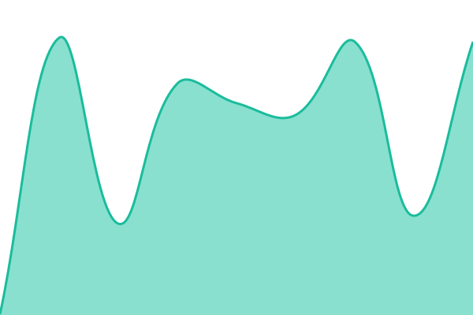
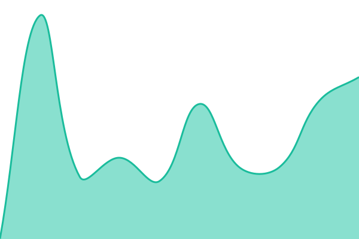

# [📈 Stato attuale · Live status](https://status.zenocms.io): <!--live status--> **🟧 Partial outage**

This repository contains the open-source uptime monitor and status page for [Armonia](https://armonia.io/), powered by [Upptime](https://github.com/upptime/upptime).

With [Upptime](https://upptime.js.org), you can get your own unlimited and free uptime monitor and status page, powered entirely by a GitHub repository. We use [Issues](https://github.com/armonia/zeno-status/issues) as incident reports, [Actions](https://github.com/armonia/zeno-status/actions) as uptime monitors, and [Pages](https://status.zenocms.io) for the status page.

## [📈 Live Status](https://demo.upptime.js.org): <!--live status--> **🟧 Partial outage**

<!--start: status pages-->
<!-- This summary is generated by Upptime (https://github.com/upptime/upptime) -->
<!-- Do not edit this manually, your changes will be overwritten -->
<!-- prettier-ignore -->
| URL | Status | History | Response Time | Uptime |
| --- | ------ | ------- | ------------- | ------ |
|  [Sito · Website](https://zenocms.io) | Attivo | [sito.yml](https://github.com/armonia/zeno-status/commits/HEAD/history/sito.yml) | 

 254ms
     
 | 

<a href="https://status.zenocms.io/history/sito">100.00%</a>
    

|  [API](https://api.zenocms.io/health) | Attivo | [api.yml](https://github.com/armonia/zeno-status/commits/HEAD/history/api.yml) | 

 236ms
     
 | 

<a href="https://status.zenocms.io/history/api">100.00%</a>
    

|  [MCP (agenti AI · AI agents)](https://api.zenocms.io/mcp) | Attivo | [mcp.yml](https://github.com/armonia/zeno-status/commits/HEAD/history/mcp.yml) | 

 301ms
     
 | 

<a href="https://status.zenocms.io/history/mcp">100.00%</a>
    

|  [Accesso · Login](https://api.zenocms.io/api/auth/ok) | Attivo | [accesso.yml](https://github.com/armonia/zeno-status/commits/HEAD/history/accesso.yml) | 

 409ms
     
 | 

<a href="https://status.zenocms.io/history/accesso">100.00%</a>
    

|  [REST dei siti · Site REST](https://api.zenocms.io/rest/v1/) | Attivo | [rest.yml](https://github.com/armonia/zeno-status/commits/HEAD/history/rest.yml) | 

 66ms
     
 | 

<a href="https://status.zenocms.io/history/rest">100.00%</a>
    

|  Domini personalizzati · Custom domains | Attivo | [domini.yml](https://github.com/armonia/zeno-status/commits/HEAD/history/domini.yml) | 

 214ms
     
 | 

<a href="https://status.zenocms.io/history/domini">9.39%</a>
    

|  [Prova finta (temporanea)](https://zeno-prova-finta.invalid) | Fermo | [prova-finta.yml](https://github.com/armonia/zeno-status/commits/HEAD/history/prova-finta.yml) | 

 0ms
     
 | 

<a href="https://status.zenocms.io/history/prova-finta">62.07%</a>
    

<!--end: status pages-->

[**Visit our status website →**](https://status.zenocms.io)

## 📄 License

- Powered by: [Upptime](https://github.com/upptime/upptime)
- Code: [MIT](./LICENSE) © [Anand Chowdhary](https://anandchowdhary.com)
- Data in the `./history` directory: [Open Database License](https://opendatacommons.org/licenses/odbl/1-0/)
